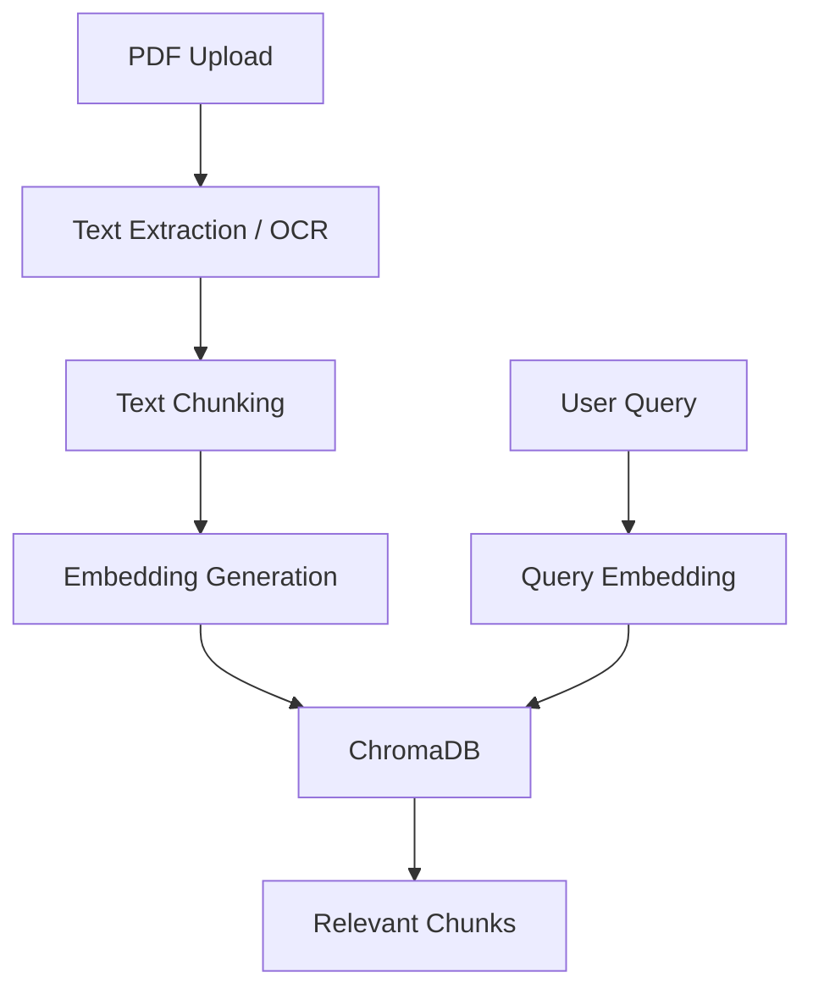

# AI Document Assistant

A Python-based document processing and semantic retrieval system that extracts information from PDFs, handles scanned documents using OCR, generates embeddings, and stores document chunks in a vector database for efficient retrieval.

## Features

- **PDF Processing:** Extract text from text-based PDF documents.
- **OCR Support:** Extract text from scanned PDFs using Tesseract OCR.
- **Text Chunking:** Split documents into overlapping chunks while preserving page metadata.
- **Embedding Generation:** Generate semantic embeddings using Sentence Transformers.
- **Vector Storage:** Store embeddings and document chunks in ChromaDB.
- **Semantic Retrieval:** Retrieve relevant document chunks using vector similarity search.

## Tech Stack

`Python` `FastAPI` `PyPDF` `Tesseract OCR` `Sentence Transformers` `ChromaDB`

## Architecture



## Getting Started

### Clone the repository

```bash
git clone https://github.com/chhaviS04/ai-document-assistant.git
cd ai-document-assistant
```

### Create a virtual environment

```bash
python -m venv venv
venv\Scripts\activate
```

### Install dependencies

```bash
pip install -r requirements.txt
```

### Install Tesseract OCR

Install Tesseract OCR for scanned document processing.

https://github.com/UB-Mannheim/tesseract/wiki

### Run the application

```bash
uvicorn app:app --reload
```

Access API documentation at:

http://127.0.0.1:8000/docs

## Project Structure

```text
ai-document-assistant/
├── app.py
├── chunking.py
├── embeddings.py
├── vector_store.py
├── test_chunking.py
├── test_embedding.py
├── test_ocr.py
├── test_vector_store.py
└── requirements.txt
```

## Author

**Chhavi Sharma**

[GitHub](https://github.com/chhaviS04)
